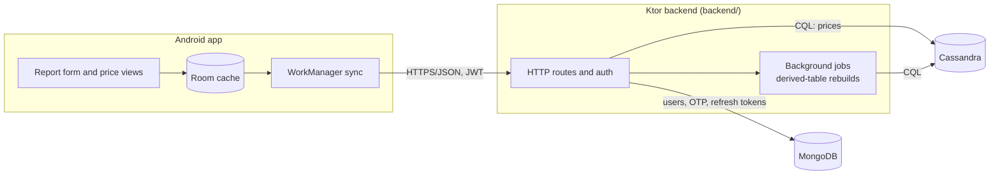
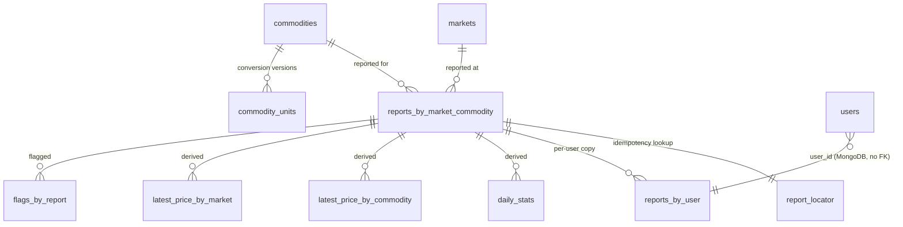

# 🛒 Soko Bei: crowdsourced market prices for Kenya

[](https://github.com/f4zzie/soko-bei/actions/workflows/ci.yml)


Traders and buyers report what a unit of a commodity (for example a crate of tomatoes) sold for at a named Kenyan market. The backend converts each report to a price per kilogram and publishes per-market and per-commodity figures: a daily median, the last reported price, the number of reports today, and a daily trend. The Android app is offline-first: reports are queued on the phone and synced when the network returns.

**Try it in one command** (Docker): `docker compose up -d --build --wait`, then `curl -s http://localhost:8080/health`. In dev mode the OTP code `000000` is accepted. Run `scripts/smoke-test.sh` for an end-to-end check.

---

## Contents

- [Background](#background)
- [Features](#features)
- [Architecture](#architecture)
- [Data design](#data-design)
- [Getting started](#getting-started)
- [Configuration](#configuration)
- [API](#api)
- [Testing and quality](#testing-and-quality)
- [Project structure](#project-structure)
- [Data to verify in the field](#data-to-verify-in-the-field)
- [Limitations and roadmap](#limitations-and-roadmap)

---

## Background

Market prices in Kenya differ a lot between towns and days, and farmers and small traders rarely see them. Soko Bei collects them from the people at the market. Seeded markets: Wakulima and Marikiti (Nairobi), Kongowea (Mombasa), Kibuye (Kisumu), Nakuru Main Market. Seeded commodities: maize, dry beans, tomatoes, onions, Irish potatoes, cabbage, sukuma wiki, bananas, rice, carrots, named in English and Kiswahili.

---

## Features

**Backend**
- Phone-number login with one-time codes; JWT access tokens and 30-day refresh tokens (revoked on logout or account deletion); consent tracking; account deletion that clears both databases.
- Idempotent report submission: an identical retry returns 200, a conflicting resubmit returns 409.
- Per-report unit conversion to KES per kg, with a versioned conversion table; business days follow Africa/Nairobi.
- Daily median, latest price and report counts per market and commodity, plus a trend endpoint.
- Background jobs that rebuild the derived tables, and an admin rebuild endpoint.
- Rate limits, Prometheus metrics at `/metrics`, and a startup guard that refuses weak secrets outside dev mode.

**Android app**
- Jetpack Compose UI with a Room cache and an outbound report queue.
- WorkManager sync with retry; token refresh; Hilt injection; DataStore settings.
- `debug`, `staging` and `release` build types; release is R8-minified and forbids cleartext HTTP.

---

## Architecture



The backend runs its background jobs in the same process as the HTTP server. Jobs can be turned off with `JOBS_ENABLED=false`.

---

## Data design

Cassandra holds all price data, MongoDB holds accounts and credentials.



- **Cassandra** (keyspace `soko_bei`, one table per query, no secondary indexes or `ALLOW FILTERING`): the source of truth `reports_by_market_commodity`, its derived caches, the catalog, `flags_by_report`, `flags_by_user` and `job_state`. Migrations `V001`-`V004` live in `backend/src/main/resources/cql/` and are checksummed by `MigrationRunner`.
- **MongoDB** (database `soko_bei`): `users` (unique index on `phone`), `otp_codes` and `refresh_tokens` (TTL indexes). Account deletion clears the user's reports' `user_id` in Cassandra and deletes the Mongo documents; it can be re-run after a crash.

### Price model

**`reports_by_market_commodity` is the only source of truth; every other price table (`latest_price_by_commodity`, `latest_price_by_market`, `daily_stats`) is a derived cache rebuildable from it.**

This is stated in the header of `backend/src/main/resources/cql/V001__schema.cql`. Practical consequences:

- Writing a report is the only write that changes prices. Derived tables can be dropped and rebuilt without losing data.
- **Conversion corrections policy:** a report keeps the `kg_per_unit`, `conversion_version` and `price_per_kg_kes` it was stored with, forever. Publishing a new `commodity_units` version (a higher `version` for the same commodity and unit) affects only reports submitted afterwards. Derived tables, including a full admin rebuild, aggregate each report's stored `price_per_kg_kes` and never recompute it from the current factor. Old and new reports of one unit are therefore deliberately not retro-corrected; if history must be restated, that is an explicit, separate data migration. A test covers this.
- The derived tables are rebuilt with the admin endpoint described below.

---

## Getting started

### Option A: Cassandra, MongoDB and backend in Docker

```sh
cp .env.example .env          # docker compose reads .env automatically
docker compose up -d --build
curl -s http://localhost:8080/health
```

Cassandra is published on `9042`, MongoDB on `27017`, the backend on `8080`. The compose file sets `DEV_MODE=true` by default, so OTP code `000000` is accepted. Do not use this in production.

### Option B: Backend from Gradle, databases in Docker

```sh
docker compose up -d cassandra mongodb

DEV_MODE=true \
ADMIN_TOKEN=dev-admin-token \
CASSANDRA_CONTACT_POINTS=localhost:9042 \
MONGODB_URI=mongodb://localhost:27017 \
./gradlew :backend:run
```

`application.conf` defaults `dev_mode` to `false` and `admin_token` to empty (which disables the admin API), so set both explicitly for local runs. With `DEV_MODE=false` the backend refuses to start unless `JWT_SECRET` and `OTP_SECRET` are non-default and at least 32 characters, and `ADMIN_TOKEN` is either empty or at least 32 characters. Migrations run at startup (`MigrationRunner`).

### Android emulator

The Android emulator reaches the host machine at `10.0.2.2`. Point the app's backend base URL at:

```
http://10.0.2.2:8080
```

### Android build types

| Build type | Command | Backend URL (Gradle property) | Cleartext HTTP | Notes |
| --- | --- | --- | --- | --- |
| `debug` | `./gradlew :android:assembleDebug` | `-PsokoDebugBaseUrl`, default `http://10.0.2.2:8080` | only `localhost` and `10.0.2.2` | emulator |
| `staging` | `./gradlew :android:assembleStaging` | `-PsokoBaseUrl`, default `http://localhost:8080` | only `localhost` and `10.0.2.2` | inherits `release` (R8, shrinking, keep rules), signed with the debug keystore, application id `ke.sokobei.app.staging` so it installs next to debug. For a real phone: `adb reverse tcp:8080 tcp:8080` |
| `release` | `./gradlew :android:assembleRelease -PsokoReleaseBaseUrl=https://your.backend` | `-PsokoReleaseBaseUrl`, required | never | the build fails while the URL is still the placeholder `https://api.sokobei.example` or is not `https`. Output is unsigned |

`./gradlew build` assembles debug and staging only; release artifacts are built explicitly so a plain build can never ship the placeholder URL. Release forbidding cleartext is enforced by `NetworkSecurityConfigTest` (unit test) and by the `verifyReleaseNetworkSecurity` Gradle task, which inspects the merged release manifest and runs under `check`.

A step-by-step manual test for a real phone is in [`docs/device-test-checklist.md`](docs/device-test-checklist.md).

### Rebuilding derived tables

```sh
curl -sS -X POST \
  -H "X-Admin-Token: $ADMIN_TOKEN" \
  "http://localhost:8080/v1/admin/rebuild?from=2026-10-16&to=2026-10-17"
```

`from` and `to` are dates (`YYYY-MM-DD`, Africa/Nairobi days) and the range is inclusive. The rebuild recomputes `daily_stats` and the latest-price tables from `reports_by_market_commodity`.

---

## Configuration

Sources: `.env.example` (compose-level values), `backend/src/main/resources/application.conf` (defaults and override names), and `docker-compose.yml` (what the backend container receives). Where the conf default and the compose default differ, both are shown.

| Variable | Default (conf / compose) | Purpose |
| --- | --- | --- |
| `PORT` | `8080` | HTTP port |
| `CASSANDRA_CONTACT_POINTS` | `localhost:9042` / `cassandra:9042` | Comma-separated host:port list |
| `CASSANDRA_LOCAL_DC` | `datacenter1` | Local datacenter name |
| `CASSANDRA_KEYSPACE` | `soko_bei` | Keyspace created by the migration runner |
| `CASSANDRA_REPLICATION` | `datacenter1:1` | `dc:rf,dc:rf`, rendered as NetworkTopologyStrategy. Production example: `datacenter1:3` |
| `CASSANDRA_STARTUP_TIMEOUT_SECONDS` | `120` | How long startup waits for Cassandra |
| `CASSANDRA_MAX_HEAP` / `CASSANDRA_HEAP_NEWSIZE` | `768M` / `128M` | Compose only: Cassandra container heap |
| `MONGODB_URI` | `mongodb://localhost:27017` | MongoDB connection string (accounts, OTP codes, refresh tokens) |
| `MONGODB_DATABASE` | `soko_bei` | MongoDB database name |
| `DEV_MODE` | `false` / `true` | Accepts OTP `000000` and logs OTP codes. Must be `false` in production |
| `JWT_SECRET` | `change-me-change-me-change-me-change-me` / dev value | JWT signing secret. With `DEV_MODE=false`: non-default and 32+ characters or startup fails |
| `OTP_SECRET` | `change-me-otp` / dev value | Secret used for OTP hashing. With `DEV_MODE=false`: non-default and 32+ characters or startup fails |
| `ADMIN_TOKEN` | empty / `dev-admin-token` | Value required in `X-Admin-Token` for admin routes. Empty disables every admin route (403). With `DEV_MODE=false` it must be 32+ characters when set |
| `REPORT_MAX_AGE_DAYS` | `14` | Reports older than this are rejected |
| `MIN_PRICE_PER_KG` | `1` | Lower bound on price per kg (KES) |
| `MAX_PRICE_PER_KG` | `100000` | Upper bound on price per kg (KES) |
| `CONSENT_VERSION` | `1` | Current consent version |
| `REPORTS_PER_HOUR` | `30` | Per-user report limit |
| `OTP_REQUESTS_PER_15MIN` | `3` | OTP request limit |
| `SMS_PROVIDER` | `console` | OTP sender. Only the console sender exists (codes go to the log); the backend warns when it is used outside dev mode |
| `JOBS_ENABLED` | `true` | Run background jobs in this process |
| `JAVA_OPTS` | `-Xmx384m` | Compose only: JVM options for the backend container |
| `SOKO_TEST_CASSANDRA` | unset | Test only: `host:port` of an external Cassandra for integration tests. Otherwise Testcontainers starts one |
| `SOKO_TEST_MONGO` | unset | Test only: MongoDB URI of an external server (otherwise Testcontainers starts one) |

---

## API

| Area | Routes |
| --- | --- |
| Health and metrics | `GET /health`, `GET /metrics` |
| Auth | `POST /v1/auth/otp/request`, `POST /v1/auth/otp/verify`, `POST /v1/auth/refresh`, `POST /v1/auth/logout` |
| Catalog | `GET /v1/markets`, `GET /v1/commodities` |
| Prices | `GET /v1/markets/{id}/prices`, `GET /v1/commodities/{id}/prices`, `GET /v1/commodities/{c}/markets/{m}/reports`, `GET /v1/commodities/{c}/markets/{m}/trend` |
| Reports | `POST /v1/reports`, `POST /v1/reports/{id}/flags`, `GET /v1/me/reports` |
| Account | `GET /v1/me`, `POST /v1/me/consent`, `DELETE /v1/me` |
| Admin | `POST /v1/admin/rebuild?from=YYYY-MM-DD&to=YYYY-MM-DD` (header `X-Admin-Token`) |

Errors use the envelope `{"error": {"code", "message", "details"}}`.

`GET /health` always returns a JSON body with a status per database and HTTP 200 only when both Cassandra and MongoDB answer (503 otherwise), for example `{"status":"ok","cassandra":"up","mongodb":"up","cassandra_version":"5.0.9"}`. While the JVM is still starting it is not listening at all, so the compose healthcheck polls `/health` and `--wait` only returns once the backend is ready.

---

## Testing and quality

```sh
./gradlew build                                   # shared + backend + Android unit tests, lint, debug and staging APKs
./gradlew :backend:test                           # backend unit + integration tests (Testcontainers; needs Docker)
./gradlew :android:testDebugUnitTest              # Android unit and Robolectric tests
./gradlew :android:connectedDebugAndroidTest      # Android instrumented tests (needs an emulator or device)
scripts/check-ignored-sources.sh                  # no source file is hidden by .gitignore / .dockerignore
BASE_URL=http://localhost:8080 ADMIN_TOKEN=dev-admin-token scripts/smoke-test.sh
```

| Suite | Count | Notes |
| --- | --- | --- |
| Backend unit + integration | 102 | Time, domain, validation, CQL splitter, startup guard, health report; integration tests use Testcontainers (Cassandra 5.0, MongoDB 8) or, with `SOKO_TEST_CASSANDRA=host:port` and `SOKO_TEST_MONGO=mongodb://host:port`, existing servers (each test gets its own keyspace and database) |
| Android unit / Robolectric | 82 | ViewModels, Room DAOs, SyncWorker, report form, wire format, network security config |
| Android instrumented | 20 | Room DAO 9, report form 3, SyncWorker 7, cleartext policy 1. Passed on a local API 34 emulator (`google_apis`, x86_64, headless); not yet run on a hosted runner |
| Compose + smoke test | all steps | `docker compose up -d --build --wait`, then `scripts/smoke-test.sh`: OTP login, consent, catalog, report (201, then identical resubmit 200), price reads, admin rebuild, logout, account deletion, old token rejected. OTP requests are rate limited, so repeat runs within 15 minutes may fail at the OTP step |
| Android release / staging builds | n/a | `./gradlew :android:assembleStaging`; `./gradlew :android:assembleRelease -PsokoReleaseBaseUrl=https://host` (R8, keep rules in `android/proguard-rules.pro`) |
| CI | 5 jobs | `.github/workflows/ci.yml`: `checks` (actionlint, shellcheck, ignore audit), `backend`, `android`, `smoke`, `instrumented`. See [Limitations](#limitations-and-roadmap) for its status |

A manual test for a real phone is in [`docs/device-test-checklist.md`](docs/device-test-checklist.md).

---

## Project structure

```
backend/                 Ktor server: api/, service/, repository/, jobs/, config/, domain/, time/, sms/
backend/src/main/resources/cql/   V001-V004 CQL migrations
backend/src/test/        unit tests and *IT integration tests (it/TestHarness.kt)
android/                 Compose app: Room cache, report queue, WorkManager sync (see android/NOTES.md)
android/src/androidTest/ instrumented tests
shared/                  DTOs and constants shared with clients (ke.sokobei.shared)
scripts/                 smoke-test.sh, check-ignored-sources.sh
docs/                    device-test-checklist.md
docker-compose.yml       Cassandra 5.0, MongoDB 8, backend
.github/workflows/       ci.yml
PROGRESS.md, DECISIONS.md   what was verified, and why things are the way they are
```

---

## Data to verify in the field

All unit conversion factors are placeholders except the `kg` unit, which is exact (`kg_per_unit = 1`). The source is `backend/src/main/resources/cql/V002__seed.cql`, which has 26 factors marked `verified = false`:

| Commodity | Unverified factors (kg per unit) |
| --- | --- |
| Maize | gorogoro 2.2, debe 18, bag_90kg 90 |
| Dry beans | gorogoro 2.0, debe 16, bag_90kg 90 |
| Tomatoes | crate 60, debe 18 |
| Onions | bag_50kg 50, debe 15, gorogoro 2.0 |
| Irish potatoes | bag_50kg 50, debe 17, gorogoro 2.2 |
| Cabbage | piece 1.5, bag_50kg 50 |
| Sukuma wiki | bunch 0.4, bag_50kg 50 |
| Bananas | bunch 15, piece 0.15 |
| Rice | gorogoro 2.0, bag_50kg 50, bag_90kg 90 |
| Carrots | crate 50, bag_50kg 50, debe 16 |

Until these are checked, per-kg prices for those units are only as good as the placeholder. Changing a factor creates a new `commodity_units` version; past reports keep the `conversion_version` they were stored with.

Kiswahili commodity names (`name_sw` in the seed: Mahindi, Maharagwe, Nyanya, Vitunguu, Viazi mviringo, Kabichi, Sukuma wiki, Ndizi, Mchele, Karoti) need review by a native speaker before release.

---

## Limitations and roadmap

- Rate limiting for OTP requests and reports is in-memory and per instance. Running several backend instances multiplies the effective limits, and concurrent OTP verifies on different instances can race.
- SMS is not wired. The only OTP sender is a console sender, so codes appear in logs in dev mode.
- No outlier filtering yet: a single bad report can move a median. Flags are stored (`flags_by_report`, `flags_by_user`) but not yet used when computing medians.
- Not verified: no run on a physical phone (the device checklist is a procedure nobody has executed), the Android app has not been exercised against the live backend, and a build on a different machine has not been done.
- CI: the GitHub Actions workflow has not been confirmed green on GitHub (this repository has no remote yet), and the instrumented job has not run on a hosted runner.
- Kiswahili names and the placeholder unit conversions need native-speaker and field review.
