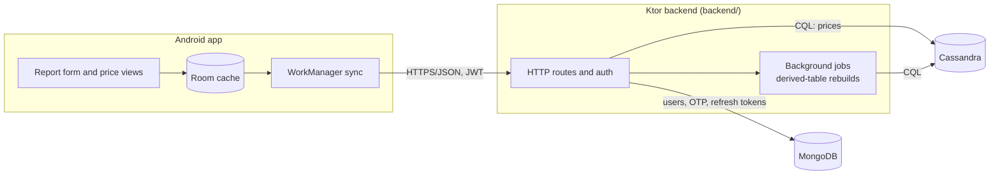

# Soko Bei

[](https://github.com/OWNER/REPO/actions/workflows/ci.yml)
<!-- Replace OWNER/REPO with the GitHub repository path once a remote exists; this repo has none yet, so the badge cannot resolve until then. -->

Soko Bei is a crowd-sourced price board for Kenyan produce markets. Traders and buyers report what a unit of a commodity (for example a crate of tomatoes) sold for at a named market. The backend converts each report to a price per kilogram, stores it, and publishes per-market and per-commodity figures: a daily median, the last reported price, and the number of reports today, plus a daily trend.

Seeded markets: Wakulima and Marikiti (Nairobi), Kongowea (Mombasa), Kibuye (Kisumu), Nakuru Main Market.
Seeded commodities: maize, dry beans, tomatoes, onions, Irish potatoes, cabbage, sukuma wiki, bananas, rice, carrots. Names are given in English and Kiswahili.

Repository layout:

| Path | Contents |
| --- | --- |
| `backend/` | Ktor server, Cassandra repositories (prices), MongoDB repositories (accounts), CQL migrations in `backend/src/main/resources/cql/` |
| `android/` | Jetpack Compose app: Room cache and outbound report queue, WorkManager sync, Ktor client. See `android/NOTES.md` |
| `shared/` | DTOs and constants shared with clients (`ke.sokobei.shared`) |
| `docker-compose.yml` | Cassandra 5.0, MongoDB 8 and the backend container |
| `scripts/smoke-test.sh` | End-to-end check against a running backend |

## Architecture



The backend runs its background jobs in the same process as the HTTP server. Jobs can be turned off with `JOBS_ENABLED=false`.

## Price model

**`reports_by_market_commodity` is the only source of truth; every other price table (`latest_price_by_commodity`, `latest_price_by_market`, `daily_stats`) is a derived cache rebuildable from it.**

This is stated in the header of `backend/src/main/resources/cql/V001__schema.cql`. Practical consequences:

- Writing a report is the only write that changes prices. Derived tables can be dropped and rebuilt without losing data.
- **Conversion corrections policy:** a report keeps the `kg_per_unit`, `conversion_version` and `price_per_kg_kes` it was stored with, forever. Publishing a new `commodity_units` version (a higher `version` for the same commodity and unit) affects only reports submitted afterwards. Derived tables, including a full admin rebuild, aggregate each report's stored `price_per_kg_kes` and never recompute it from the current factor. Old and new reports of one unit are therefore deliberately not retro-corrected; if history must be restated, that is an explicit, separate data migration. A test covers this.
- The derived tables are rebuilt with the admin endpoint described below.

## Running locally

### Option A: Cassandra, MongoDB and backend in Docker

```sh
cp .env.example .env          # docker compose reads .env automatically
docker compose up -d --build
curl -s http://localhost:8080/health
```

Cassandra is published on `9042`, MongoDB on `27017`, the backend on `8080`. The compose file sets `DEV_MODE=true` by default, so OTP code `000000` is accepted. Do not use this in production.

### Option B: Backend from Gradle, databases in Docker

```sh
docker compose up -d cassandra mongodb

DEV_MODE=true \
ADMIN_TOKEN=dev-admin-token \
CASSANDRA_CONTACT_POINTS=localhost:9042 \
MONGODB_URI=mongodb://localhost:27017 \
./gradlew :backend:run
```

`application.conf` defaults `dev_mode` to `false` and `admin_token` to empty (which disables the admin API), so set both explicitly for local runs. With `DEV_MODE=false` the backend refuses to start unless `JWT_SECRET` and `OTP_SECRET` are non-default and at least 32 characters, and `ADMIN_TOKEN` is either empty or at least 32 characters. Migrations run at startup (`MigrationRunner`).

### Android emulator

The Android emulator reaches the host machine at `10.0.2.2`. Point the app's backend base URL at:

```
http://10.0.2.2:8080
```

### Android build types

| Build type | Command | Backend URL (Gradle property) | Cleartext HTTP | Notes |
| --- | --- | --- | --- | --- |
| `debug` | `./gradlew :android:assembleDebug` | `-PsokoDebugBaseUrl`, default `http://10.0.2.2:8080` | only `localhost` and `10.0.2.2` | emulator |
| `staging` | `./gradlew :android:assembleStaging` | `-PsokoBaseUrl`, default `http://localhost:8080` | only `localhost` and `10.0.2.2` | inherits `release` (R8, shrinking, keep rules), signed with the debug keystore, application id `ke.sokobei.app.staging` so it installs next to debug. For a real phone: `adb reverse tcp:8080 tcp:8080` |
| `release` | `./gradlew :android:assembleRelease -PsokoReleaseBaseUrl=https://your.backend` | `-PsokoReleaseBaseUrl`, required | never | the build fails while the URL is still the placeholder `https://api.sokobei.example` or is not `https`. Output is unsigned |

`./gradlew build` assembles debug and staging only; release artifacts are built explicitly so a plain build can never ship the placeholder URL. Release forbidding cleartext is enforced by `NetworkSecurityConfigTest` (unit test) and by the `verifyReleaseNetworkSecurity` Gradle task, which inspects the merged release manifest and runs under `check`.

A step-by-step manual test for a real phone is in [`docs/device-test-checklist.md`](docs/device-test-checklist.md).

## Environment variables

Sources: `.env.example` (compose-level values), `backend/src/main/resources/application.conf` (defaults and override names), and `docker-compose.yml` (what the backend container receives). Where the conf default and the compose default differ, both are shown.

| Variable | Default (conf / compose) | Purpose |
| --- | --- | --- |
| `PORT` | `8080` | HTTP port |
| `CASSANDRA_CONTACT_POINTS` | `localhost:9042` / `cassandra:9042` | Comma-separated host:port list |
| `CASSANDRA_LOCAL_DC` | `datacenter1` | Local datacenter name |
| `CASSANDRA_KEYSPACE` | `soko_bei` | Keyspace created by the migration runner |
| `CASSANDRA_REPLICATION` | `datacenter1:1` | `dc:rf,dc:rf`, rendered as NetworkTopologyStrategy. Production example: `datacenter1:3` |
| `CASSANDRA_STARTUP_TIMEOUT_SECONDS` | `120` | How long startup waits for Cassandra |
| `CASSANDRA_MAX_HEAP` / `CASSANDRA_HEAP_NEWSIZE` | `768M` / `128M` | Compose only: Cassandra container heap |
| `MONGODB_URI` | `mongodb://localhost:27017` | MongoDB connection string (accounts, OTP codes, refresh tokens) |
| `MONGODB_DATABASE` | `soko_bei` | MongoDB database name |
| `DEV_MODE` | `false` / `true` | Accepts OTP `000000` and logs OTP codes. Must be `false` in production |
| `JWT_SECRET` | `change-me-change-me-change-me-change-me` / dev value | JWT signing secret. With `DEV_MODE=false`: non-default and 32+ characters or startup fails |
| `OTP_SECRET` | `change-me-otp` / dev value | Secret used for OTP hashing. With `DEV_MODE=false`: non-default and 32+ characters or startup fails |
| `ADMIN_TOKEN` | empty / `dev-admin-token` | Value required in `X-Admin-Token` for admin routes. Empty disables every admin route (403). With `DEV_MODE=false` it must be 32+ characters when set |
| `REPORT_MAX_AGE_DAYS` | `14` | Reports older than this are rejected |
| `MIN_PRICE_PER_KG` | `1` | Lower bound on price per kg (KES) |
| `MAX_PRICE_PER_KG` | `100000` | Upper bound on price per kg (KES) |
| `CONSENT_VERSION` | `1` | Current consent version |
| `REPORTS_PER_HOUR` | `30` | Per-user report limit |
| `OTP_REQUESTS_PER_15MIN` | `3` | OTP request limit |
| `JOBS_ENABLED` | `true` | Run background jobs in this process |
| `JAVA_OPTS` | `-Xmx384m` | Compose only: JVM options for the backend container |
| `SOKO_TEST_CASSANDRA` | unset | Test only: `host:port` of an external Cassandra for integration tests. Otherwise Testcontainers starts one |
| `SOKO_TEST_MONGO` | unset | Test only: MongoDB URI of an external server (otherwise Testcontainers starts one) |

## API

| Area | Routes |
| --- | --- |
| Health and metrics | `GET /health`, `GET /metrics` |
| Auth | `POST /v1/auth/otp/request`, `POST /v1/auth/otp/verify`, `POST /v1/auth/refresh`, `POST /v1/auth/logout` |
| Catalog | `GET /v1/markets`, `GET /v1/commodities` |
| Prices | `GET /v1/markets/{id}/prices`, `GET /v1/commodities/{id}/prices`, `GET /v1/commodities/{c}/markets/{m}/reports`, `GET /v1/commodities/{c}/markets/{m}/trend` |
| Reports | `POST /v1/reports`, `POST /v1/reports/{id}/flags`, `GET /v1/me/reports` |
| Account | `GET /v1/me`, `POST /v1/me/consent`, `DELETE /v1/me` |
| Admin | `POST /v1/admin/rebuild?from=YYYY-MM-DD&to=YYYY-MM-DD` (header `X-Admin-Token`) |

Errors use the envelope `{"error": {"code", "message", "details"}}`.

## Rebuilding derived tables

```sh
curl -sS -X POST \
  -H "X-Admin-Token: $ADMIN_TOKEN" \
  "http://localhost:8080/v1/admin/rebuild?from=2026-10-16&to=2026-10-17"
```

`from` and `to` are dates (`YYYY-MM-DD`, Africa/Nairobi days) and the range is inclusive. The rebuild recomputes `daily_stats` and the latest-price tables from `reports_by_market_commodity`.

## Tests

| Suite | Command | Notes |
| --- | --- | --- |
| Backend unit tests | `./gradlew :backend:test` | Time, domain, validation and CQL splitter tests under `backend/src/test/` |
| Backend integration tests | `./gradlew :backend:test` | Use Testcontainers (Cassandra and MongoDB) by default. Set `SOKO_TEST_CASSANDRA=host:port` and `SOKO_TEST_MONGO=mongodb://host:port` to use existing servers instead (each test gets its own keyspace and database) |
| Android unit tests | `./gradlew :android:testDebugUnitTest` | ViewModels, Room DAOs, SyncWorker and the report form under Robolectric. Instrumented tests need an emulator and were not run |
| Android release build | `./gradlew :android:assembleRelease -PsokoReleaseBaseUrl=https://host` | R8 minification and resource shrinking enabled; keep rules in `android/proguard-rules.pro` |
| Android staging build | `./gradlew :android:assembleStaging` | Same R8 setup as release, debug-signed, installs next to debug |
| Smoke test | `BASE_URL=http://localhost:8080 ADMIN_TOKEN=dev-admin-token scripts/smoke-test.sh` | Needs a running backend with `DEV_MODE=true`. Requires `curl` and `jq` |

The smoke test waits up to 120 seconds for `/health` to report Cassandra as up, then walks through OTP login, consent, catalog, a report submission (201, then an identical resubmit returns 200), price reads, an admin rebuild, logout, account deletion and a check that the old token is rejected. OTP requests are rate limited, so repeat runs within 15 minutes may fail at the OTP step.

## Data to verify in the field

All unit conversion factors are placeholders except the `kg` unit, which is exact (`kg_per_unit = 1`). The source is `backend/src/main/resources/cql/V002__seed.cql`, which has 26 factors marked `verified = false`:

| Commodity | Unverified factors (kg per unit) |
| --- | --- |
| Maize | gorogoro 2.2, debe 18, bag_90kg 90 |
| Dry beans | gorogoro 2.0, debe 16, bag_90kg 90 |
| Tomatoes | crate 60, debe 18 |
| Onions | bag_50kg 50, debe 15, gorogoro 2.0 |
| Irish potatoes | bag_50kg 50, debe 17, gorogoro 2.2 |
| Cabbage | piece 1.5, bag_50kg 50 |
| Sukuma wiki | bunch 0.4, bag_50kg 50 |
| Bananas | bunch 15, piece 0.15 |
| Rice | gorogoro 2.0, bag_50kg 50, bag_90kg 90 |
| Carrots | crate 50, bag_50kg 50, debe 16 |

Until these are checked, per-kg prices for those units are only as good as the placeholder. Changing a factor creates a new `commodity_units` version; past reports keep the `conversion_version` they were stored with.

Kiswahili commodity names (`name_sw` in the seed: Mahindi, Maharagwe, Nyanya, Vitunguu, Viazi mviringo, Kabichi, Sukuma wiki, Ndizi, Mchele, Karoti) need review by a native speaker before release.

## Known limitations

- Rate limiting for OTP requests and reports is in-memory and per instance. Running several backend instances multiplies the effective limits.
- SMS is not wired. The only OTP sender is a console sender, so codes appear in logs in dev mode.
- No outlier filtering yet. A single bad report can move a median.
- Flags are stored (`flags_by_report`, `flags_by_user`) but are not yet used when computing medians.
- OTP attempt counting is only safe per instance; concurrent verifies on different instances can race.
- Android was verified only by JVM/Robolectric unit tests; there is no emulator here, so instrumented tests and manual runs of the screens did not happen. See `android/NOTES.md`.

## Data stores

- **Cassandra** holds all price data: the source of truth `reports_by_market_commodity`, its derived caches, the catalog, flags and job state.
- **MongoDB** holds accounts and credentials: `users` (unique index on `phone`, replacing the old Cassandra LWT), `otp_codes` and `refresh_tokens` (TTL indexes). Account deletion clears the user's reports' `user_id` in Cassandra and deletes the Mongo documents.

## Verification status (what was actually run)

- Backend: 84 tests (unit plus integration) pass against a real Cassandra 5.0.9 and MongoDB 8.0 started natively, using `SOKO_TEST_CASSANDRA` and `SOKO_TEST_MONGO`.
- `scripts/smoke-test.sh` passes against a natively started backend.
- `docker compose up -d --build`, then `docker compose down -v && docker compose up -d`, each followed by the smoke test: all steps pass.
- The Testcontainers path also passed (`./gradlew clean build` with Docker access and no `SOKO_TEST_*` variables).
- NOT run: the Android instrumented tests (no emulator).
